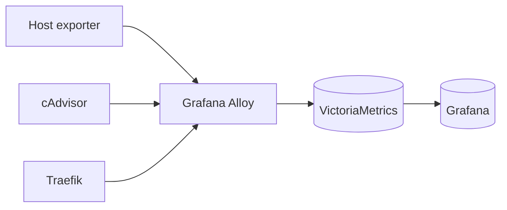

# ServiceHub Monitoring and Alerting

> **Status note (ADR-009 and ADR-010).** [ADR-010](../architecture/adr/ADR-010-establish-servicehub-observability-platform.md), now Accepted, partially supersedes ADR-009's observability retirement. The self-hosted observability stack is included in OCI scope, but Phase 1 deployment and runtime verification are pending. LiteLLM, local `aiserv` services, Stalwart, Bulwark, and other relocated mail-platform telemetry are outside ADR-010.

The Project Owner approved local Phase 5 static validation on 2026-10-20. Implementation through Phase 3 is complete in repository at `6eb4c1e96cab58ba3f819c3b24e629b52fa4876d`; the approved validation revision is `58c8c6d4d606ee93dc43521b6deaef29fbbfa9fc`. Integrated OCI runtime validation, OCI APM, notification delivery, and Confluence JMX remain deferred or pending as defined in [ADR-010 Phase 5 OCI Validation](runbooks/ADR-010-PHASE-5-OCI-VALIDATION.md). ADR-010 is not runtime verified.

## Baseline Topology

The baseline observability services are Grafana Alloy, VictoriaMetrics, VictoriaLogs, and Grafana. Alloy is the single authoritative metrics ingestion path: it collects host, container, Traefik, and Alloy self-metrics and remote-writes them to VictoriaMetrics. VictoriaMetrics has no direct scrape configuration. Alloy also discovers Docker container logs, enriches Traefik access logs with GeoIP, and pushes them to VictoriaLogs. Grafana queries both stores over the internal Docker network.

VictoriaMetrics and VictoriaLogs retain loopback-only host ports for host-side validation. They are not routed through Traefik. Grafana and Alloy use internal Docker DNS names. The deploy workflow does not deploy `obsvce*`; deployment remains manual pending the Phase 5 decision. LiteLLM, `aiserv`, Stalwart, Bulwark, `mailsv`, and all relocated mail-platform telemetry have no active OCI observability pipeline.

## Foundational Collection

Host, container, Traefik, blackbox, and Alloy self-metrics are implemented in configuration; runtime verification pending. The Unix exporter uses read-only `/host/root`, `/host/proc`, and `/host/sys` mounts. Filesystem and inode collectors exclude pseudo-filesystems while retaining actual host filesystem capacity and read-only state. The root mount is read-only but exposes broad host-readable content to Alloy; it remains a privileged read boundary.

Journald sources are filtered to SSH, sudo, logind, kernel, Docker, systemd, and firewalld events for 24 hours. Journald collection is implemented in configuration; runtime verification pending. The host must add the Alloy container's runtime identity to the `systemd-journal` group on OCI before Phase 5; the group ID is not guessed in Git.

Container logs pass through Alloy's secret filter before GeoIP processing. Sensitive-value redaction is implemented in configuration; runtime verification pending. Traefik access-log `ClientHost` is treated as the TCP source for log investigation. Traefik's former Prometheus `X-Forwarded-For` header label remains disabled in Alloy; individual client IPs are not promoted to metric labels. A trusted-proxy chain review is a Phase 5 prerequisite before making any stronger source-trust claim.

Internal blackbox probes use Traefik `/ping`, Authentik `/-/health/ready/`, Confluence `/status`, Forgejo `/api/healthz`, oCIS `/status.php`, Grafana `/api/health`, VictoriaMetrics `/health`, and VictoriaLogs `/health`. Public HTTPS probes verify DNS, TLS handshake, certificate validity, and response duration. Probes are implemented in configuration; runtime verification pending. Self-monitoring covers scrape/remote-write failures and service availability. Grafana cannot reliably report its own total failure; OCI Monitoring is the required external watchdog and remains a manual Phase 5 action.

Docker local log rotation is not established by repository authority. Confirm or configure the OCI Docker daemon rotation policy during Phase 5.

## Native Application Telemetry

Authentik server and worker metrics are scraped on internal port 9300; the stack has no applicable external outpost configured. oCIS proxy metrics are scraped on internal debug port 9205. Both scrape paths are implemented in configuration; runtime verification pending. Container logs are normalized with bounded `service` and `component` labels. Authentik `level` is promoted only when its JSON source emits it; usernames, request IDs, provider details, and diagnostic text remain fields.

## Database and Deeper Application Telemetry

Alloy's embedded PostgreSQL exporter connects through runtime-only `POSTGRES_EXPORTER_*` values. No credential is committed. The role creation instructions are in the PostgreSQL service guide.

PostgreSQL telemetry status, runtime verified on the OCI host:

| Category | Status |
|---|---|
| Availability (`pg_up`) | Runtime verified |
| Activity and connections (`pg_stat_database_numbackends`, `pg_stat_activity_count`) | Runtime verified |
| Commits and rollbacks (`pg_stat_database_xact_commit`, `xact_rollback`) | Runtime verified |
| Locks (locks collector) | Runtime verified |
| Deadlocks (`pg_stat_database_deadlocks`) | Runtime verified |
| Database size (`pg_database_size_bytes`) | Runtime verified |
| Cache and block statistics (`pg_stat_database_blks_hit`, `blks_read`) | Runtime verified |
| Temporary files and bytes (`pg_stat_database_temp_files`, `temp_bytes`) | Runtime verified |
| Exporter health (`pg_up`, `pg_scrape_collector_success`) | Runtime verified |
| WAL (`pg_wal_segments`, `pg_wal_size_bytes`) | Runtime verified |
| User-table metrics (`pg_stat_user_tables`, `pg_statio_user_tables`) | Collector healthy; zero samples |
| Vacuum progress (`pg_stat_progress_vacuum`) | Collector healthy; zero samples |

A collector health metric of `1` confirms the collector ran, not that it produced samples. User-table and vacuum-progress collectors report success while currently returning no series, because the monitored database has no qualifying activity. The exporter does not emit `pg_wal_lsn_diff`; the WAL indicators available are `pg_wal_segments` and `pg_wal_size_bytes`.

## DEV follow-up status (2026-10-20)

| Area | Status | Notes |
|---|---|---|
| Forgejo Actions Runner | Runtime verified | Registered as `devopsrunner`, label `ssh-deploy:host`, matching `runs-on: ssh-deploy` |
| Runner alert recovery | Runtime verified | `servicehub-runner-warning` evaluates Normal |
| Confluence JMX | Blocked | No approved exporter artifact or checksum exists; owner decision required |
| Notification delivery | Blocked | No approved contact point or credential exists |
| External watchdog | Blocked | No approved external provider or endpoint exists |
| Retention | Deferred | Both stores are unlimited; DEV sizing needs an owner observation window |
| Alert thresholds | Validated and retained | All thresholds have headroom on observed DEV data; none changed |
| OCI APM | Deferred (disabled) | Scaffolding is inert; logs disabled by policy |

**Forgejo Actions Runner.** The runner is deployed and registered. Registration was
confirmed from the runner's own record: name `devopsrunner`, internal address
`http://devopsforgejo:3000`, labels `["ssh-deploy:host"]`, and a stored token. The
runner declared itself successfully and is polling the `nexora/servicehub` repository.
Both repository workflows (`61-deploy.yml`, `71-backup.yml`) declare `runs-on: ssh-deploy`,
which matches the advertised label, so job pickup is compatible.

The runner alert previously fired because its selector matched the short service name
`devopsrunner` while cAdvisor reports the Compose container name
`servicehub-devopsrunner-1`, so the query returned no series and the rule fired on
`noDataState`. The selector now uses the stable Compose service label
`container_label_com_docker_compose_service="devopsrunner"`, which is correct across
container renames. The alert evaluates Normal.

**Runner security boundaries (reviewed, unchanged).** The runner is not privileged, has
no added capabilities, no Docker socket mount, no host PID or IPC namespace, no host
network namespace, and no published ports. It runs as root inside its own container with
four mounts, all scoped to Forgejo data: read-only runner config, the runner data
directory, the host-mode workspace, and the `/data` volume. Capacity is 1, jobs run in
host mode rather than in job containers, and cache is enabled. Because the runner shares
the `subnet` network it can reach PostgreSQL, Grafana, and VictoriaMetrics by service
name; this is inherent to host-mode execution and is recorded rather than changed. No
privilege, mount, network, or scope was widened.

**Runner workflow execution test — Blocked.** A controlled job could not be dispatched
because no Forgejo API or administrative credential is available in this environment:
unauthenticated API access returns 403 and `.env` holds no Forgejo admin token. Both
existing workflows deploy to remote hosts over SSH and are not DEV-safe to dispatch, so
neither was run. Job pickup, checkout, action retrieval, log upload, and cleanup therefore
remain **Runtime verification pending**. This is a credential dependency, not a runner
defect; the runner is registered and polling.

**Log ingestion (Runtime verified).** All twelve running containers deliver logs to
VictoriaLogs. Highest volume is Traefik access logs, then Grafana and Authentik; the
runner has produced only startup lines, consistent with no job having run.

**Alert thresholds (validated and retained).** Every threshold was compared with observed
DEV values and none were changed, because no threshold is firing and all have headroom:
filesystem usage peaked at 67.9% against an 85% warning and 95% critical; inode usage
9.5% against 95% critical; CPU, memory and I/O pressure at 0.042, 0.0007 and 0.0116
against a 0.2 threshold; Traefik p95 latency 0.675 s against 2 s; telemetry ingestion
failures 0; PostgreSQL backends 23 against a pool maximum of 125; TLS certificates 78 to
87 days remaining against a 14-day threshold. Thresholds were not changed to silence
anything, and a ten-hour DEV window is too short to justify retuning.

**Retention (Deferred).** Neither VictoriaMetrics nor VictoriaLogs has a retention period
configured, so both are unlimited and constrained only by disk. Observed after roughly
ten hours: VictoriaMetrics 12 MB with 13,519 active series and about 217 samples/s
ingestion; VictoriaLogs 30 MB. Grafana storage is 326 MB. Host disk is 67% used with
25 GB available. Because the observation window is a single DEV day, production retention
must not be inferred from it. Setting retention would begin deleting existing telemetry
and therefore needs explicit owner approval.

**Alert selector defects corrected.** The Traffic Edge "TLS state and certificate expiry"
panel queried `component="public-probe"`, which exists in no series, so both targets were
empty. It now uses the observed external HTTPS selector and returns six series, matching
the correction already applied to `servicehub-tls-expiry`.

**Known dashboard data gap.** On the Applications dashboard, the `$service` template
variable is populated from `probe_success`, so it holds short names such as `traefik`.
Several panels then query `container_*` and `traefik_service_requests_total` labels that
use different forms (`servicehub-routetraefik-1` and `webappconf@docker`), so those panels
stay empty. This is a pre-existing label-namespace inconsistency. It was not redesigned
here because the approved DEV scope covers runner, Confluence JMX, notification delivery,
watchdog, retention, thresholds, OCI APM scaffolding and evidence; correcting the
dashboard label model is a separate change.

**OCI APM (Deferred, disabled).** Scaffolding exists and is inert. While
`OCI_APM_ENABLED=false` no exporter component is instantiated, because no OTLP or
OpenTelemetry component exists in any Alloy configuration; no DNS lookup or connection to
an OCI APM endpoint is attempted; Alloy starts normally; and the VictoriaMetrics and
VictoriaLogs pipelines are unaffected. Enabling it without an endpoint or data key fails
preflight naming only the missing variable, without printing values and without falling
back to an anonymous endpoint. **OCI APM log export is disabled by policy**:
`OCI_APM_LOGS_ENABLED=true` is rejected at preflight and must remain `false`. Endpoint and
data key are supplied only through the server-side `.env`. Traces are the only intended
future signal, and **no ServiceHub application currently emits OTLP traces**, so trace
validation is additionally blocked on application instrumentation.

## Phase 5 acceptance evidence (2026-10-20)

- PostgreSQL telemetry is runtime verified, and the WAL collector is runtime verified.
- The WAL metrics available from the deployed exporter are `pg_wal_size_bytes` and `pg_wal_segments`. `pg_wal_lsn_diff` is not emitted and must not be queried.
- The Database dashboard WAL panel now uses `pg_wal_size_bytes` (gauge, not wrapped in `rate()`); all 12 Database dashboard query targets return data.
- The PostgreSQL alert `servicehub-postgresql-critical` is Normal. `noDataState: Alerting` is retained by owner decision, so an unexpected absence of `pg_up` is treated as a monitoring failure. The accepted tradeoff is that an intentional exporter disablement, an Alloy outage, an Alloy recreation exceeding the pending duration, or a PostgreSQL scrape failure may fire the alert.
- Credentials are stored outside Git, in the server-side `.env` at mode 600 only. No password, hash, or DSN is committed to the repository, documentation, dashboards, or evidence files.
- The monitoring-role password was rotated after transcript exposure of the previous value. The rotation preserved all role attributes, `pg_monitor` membership, `CONNECT`, and the existing function ACLs. No secret value is recorded in this repository.

Confluence JMX monitoring remains **Blocked** in DEV. Atlassian JMX and App Monitoring are enabled in the Confluence administration UI, but no JMX-to-Prometheus exporter is installed. The repository defines no approved exporter artifact or checksum; ADR-010 states only that such an exporter "SHOULD be added in a later implementation phase". Selecting and committing an exporter version is an owner decision and was not made. Observed runtime facts for that decision: Confluence 24.04, Temurin Java 21, no `jmxremote` system property (Atlassian JMX is in-process, not RMI), internal port 8060 free, and `JVM_SUPPORT_RECOMMENDED_ARGS` is the supported hook for adding a `-javaagent` argument. No exporter binary, checksum, or arbitrary release is committed. Forgejo server and runner logs are normalized as `service="forgejo"` with `component="server"` or `component="runner"`, and runner absence uses cAdvisor's last-seen metric. This is implemented in configuration; runtime verification pending.

## Monitoring Objectives

- Detect unavailable services and failed health checks.
- Detect ingress, TLS, identity, database, AI, and telemetry failures.
- Understand host, container, network, and disk pressure.
- Correlate service logs with deployment and configuration changes.
- Detect missing or failed backups after RFC-001 defines the required controls.
- Provide evidence for tests, releases, incidents, and capacity decisions.

No current alert-delivery or ownership evidence exists in the repository.

## Metrics Pipeline

- Alloy collects host, container, Traefik, and self metrics.
- VictoriaMetrics has no direct scrape configuration; Alloy remote-writes all metrics.
- VictoriaMetrics publishes port 8428 to the host.
- Grafana uses the provisioned VictoriaMetrics data source.

Metric presence and query results are `Requires runtime validation`.

## Logs Pipeline

Alloy discovers Docker container logs through `/var/run/docker.sock`, applies GeoIP enrichment to Traefik access logs, and pushes logs to VictoriaLogs at `obsvcevlogs:9428`.

VictoriaLogs publishes port 9428 to the host. Grafana uses the provisioned VictoriaLogs data source. Log availability, labels, and retention require runtime validation.

## Dashboards

Grafana provisions JSON files from `shared/grafana/dashboards/`. ServiceHub-owned dashboards are in the root directory; retained community and vendor dashboards are under `reference/` and are not the authoritative operational interface. All dashboard queries are `Runtime verification pending` unless a panel explicitly says otherwise.

| Dashboard file | Intended signal |
|---|---|
| `servicehub-overview.json` / UID `servicehub-overview` | Operational overview |
| `servicehub-infrastructure.json` / UID `servicehub-infrastructure` | Host resource capacity and pressure |
| `servicehub-docker-containers.json` / UID `servicehub-docker-containers` | Container state, resources, lifecycle, and logs |
| `servicehub-traffic-edge.json` / UID `servicehub-traffic-edge` | Traefik traffic, latency, TLS, and bounded GeoIP |
| `servicehub-security.json` / UID `servicehub-security` | Host, edge, identity, and Forgejo security views |
| `servicehub-applications.json` / UID `servicehub-applications` | Application availability, requests, resources, and logs |
| `servicehub-database.json` / UID `servicehub-database` | PostgreSQL health and capacity |
| `servicehub-observability-health.json` / UID `servicehub-observability-health` | Collector, stores, datasource, ingestion, and alert state |
| `reference/*.json` | Reference dashboards only |

Dashboard titles, queries, and datasource compatibility are `Requires runtime validation`.

## Platform Signals

| Area | Repository signal | Alert state |
|---|---|---|
| Traefik | `/ping` health, Prometheus metrics, JSON access logs | Alert definition `TBD` |
| Host | Alloy Unix exporter for CPU, memory, network, disk | Thresholds `TBD` |
| Containers | cAdvisor metrics and Docker logs | Thresholds `TBD` |
| Compose health | Service `healthcheck` definitions | Collection into alerts `TBD` |
| Disk capacity | Host exporter and archive warnings | Alert definition `TBD` |
| Backup | Workflow success or failure | Notification integration `TBD` |
| Deployment | Workflow success or failure | Notification integration `TBD` |

## Service-Specific Signals

| Service | Candidate signal |
|---|---|
| Authentik | Server and worker health, login errors, outpost errors |
| Forgejo | `/api/healthz`, request errors, database errors |
| Runner | Process health, non-empty `.runner`, workflow failures |
| Confluence | `/status`, JVM or database errors |
| Open WebUI | Route and container logs |
| Hermes | `/health`, API errors, workspace errors |
| llama.cpp | `/health`, model-load and resource errors |
| PostgreSQL | `pg_isready`, connection and storage errors |
| MariaDB | MariaDB health, connection and storage errors |
| VictoriaMetrics | `/health`, storage and ingestion errors |
| VictoriaLogs | `/health`, ingestion and storage errors |
| Grafana | `/api/health`, datasource query failures |

Candidate signals are not configured alerts unless repository evidence says otherwise.

## Alert Severity Model

**Proposed and requires owner approval:**

| Severity | Meaning | Response expectation |
|---|---|---|
| Critical | Data loss, security exposure, or platform-wide outage | Immediate escalation; response target TBD |
| High | Major service or recovery control unavailable | Urgent response; target TBD |
| Medium | Degraded service or rising risk | Same-day review; target TBD |
| Low | Informational or capacity trend | Planned review |

No severity thresholds or response targets are committed.

## Recommended Alert Categories

- Ingress, HTTP redirect, and certificate expiry or failure.
- Authentik or forward-auth outage.
- Database health, storage, replication if later added, and connection failures.
- Forgejo or runner unavailability and repeated workflow failure.
- AI local model failure, cloud provider failure, and unexpected privacy-route fallback.
- Host CPU, memory, disk, inode, and network saturation.
- Container restart loops and failed health checks.
- VictoriaMetrics or VictoriaLogs ingestion or query failure.
- Grafana datasource failure.
- Backup missing, failed, too old, too small, or unreadable.
- Restore test overdue once RFC-001 is decided.

## Alert Inventory

Grafana-managed rules are provisioned from `shared/grafana/provisioning/alerting/servicehub.yml` into the `ServiceHub Alerts` folder. Alert evaluation is implemented in configuration; runtime verification pending. Notification delivery is deferred pending owner-selected contact point.

| Rule UID | Severity | Signal | No-data state |
|---|---|---|---|
| `servicehub-fs-critical` | Critical | Filesystem above 95% | Alerting |
| `servicehub-inode-critical` | Critical | Inodes above 95% | Alerting |
| `servicehub-fs-readonly` | Critical | Filesystem read-only | Alerting |
| `servicehub-traefik-critical` | Critical | Traefik probe failed | Alerting |
| `servicehub-authentik-critical` | Critical | Authentik server or worker probe failed | Alerting |
| `servicehub-confluence-critical` | Critical | Confluence probe failed | Alerting |
| `servicehub-forgejo-critical` | Critical | Forgejo probe failed | Alerting |
| `servicehub-ocis-critical` | Critical | oCIS probe failed | Alerting |
| `servicehub-container-restart-loop` | Critical | Container restarted more than twice in 10m | NoData |
| `servicehub-container-oom` | Critical | Container OOM increase | NoData |
| `servicehub-telemetry-ingestion` | Critical | Alloy remote-write failures | Alerting |
| `servicehub-postgresql-critical` | Critical | `pg_up` unavailable | Alerting |
| `servicehub-fs-warning` | Warning | Filesystem above 85% | NoData |
| `servicehub-cpu-pressure` | Warning | Sustained CPU PSI | NoData |
| `servicehub-memory-pressure` | Warning | Sustained memory PSI | NoData |
| `servicehub-io-pressure` | Warning | Sustained I/O PSI | NoData |
| `servicehub-tls-expiry` | Warning | Public certificate expires within 14 days | NoData |
| `servicehub-traefik-5xx` | Warning | Sustained 5xx ratio above 5% | NoData |
| `servicehub-traefik-latency` | Warning | Traefik p95 latency above 2s | NoData |
| `servicehub-runner-warning` | Warning | Forgejo Actions Runner absent from cAdvisor last-seen | Normal |

Metric names for node_exporter, cAdvisor, Traefik, and Alloy remote-write counters are based on current collection configuration and exporter conventions. Label values and exact series require runtime verification. There is no backup-success telemetry rule because the current backup implementation does not yet provide a reliable repository-defined metric.

## Notification and Ownership

| Item | Value |
|---|---|
| Notification channel | TBD |
| Critical recipient | TBD |
| High recipient | TBD |
| Service owners | Requires owner review |
| Backup owner | Requires owner review |
| Security owner | Requires owner review |
| Escalation contact | TBD |

Grafana has `GF_ALERTING_enabled=true` and `GF_ALERTING_render_only_panels=true`, but no repository evidence defines notification channels or delivery.

## Alert Testing

Alert testing is `Not Executed`.

A future test must:

1. Trigger or simulate each severity.
2. Confirm route, deduplication, recipient, and acknowledgement.
3. Record timestamps and evidence.
4. Confirm quiet-period and recovery behaviour.
5. Verify backup and restore alerts after their controls exist.

## Retention Considerations

| Data | Repository evidence | Decision |
|---|---|---|
| Database backup archives | Approved protected retention input; value not tracked here | Confirm required value and successful retention execution |
| Full archives | Approved protected retention input; value not tracked here | Confirm required value and successful retention execution |
| VictoriaMetrics | No retention option in Compose | TBD |
| VictoriaLogs | No retention option in Compose | TBD |
| Grafana database | Persisted indefinitely under `APPS_DATA` | Review growth |
| Audit and access logs | Collected if containers emit them | Retention and access policy TBD |

Retention remains undecided and must be finalized only after measured Phase 5 ingestion and storage growth.

## Phase 5 Evidence Checklist

- OCI checkout and container state inspected and preserved before deployment.
- `docker compose config --quiet`, image builds, product/version capture, and startup logs recorded.
- VictoriaMetrics, VictoriaLogs, Grafana, and Alloy health checks recorded.
- Host, filesystem, inode, cAdvisor, probe, application, and database metrics queried.
- Journald, Docker, Traefik, GeoIP, application, and observability logs queried.
- Every dashboard and provisioned alert rendered or evaluated.
- Alert firing, recovery, no-data, execution-error, and notification behavior recorded.
- Excluded-service metrics, probes, dashboards, and log pipelines verified absent.
- Docker log rotation, retention, and storage growth recorded.
- Rollback procedure rehearsed or documented and validated.

## Related Documents

- [Component catalogue](../architecture/COMPONENT-CATALOGUE.md)
- [Service inventory](SERVICE-INVENTORY.md)
- [Troubleshooting](TROUBLESHOOTING.md)
- [RFC-001](../rfc/RFC-001-reliability-and-recovery-baseline.md)
